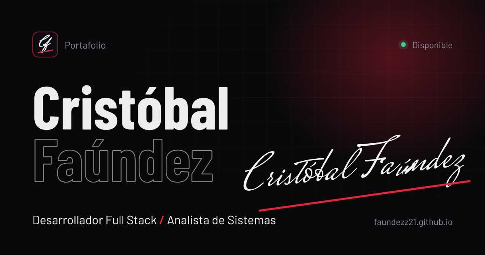

<h1 align="center">Portafolio · Cristóbal Faúndez</h1>

<p align="center">
  <a href="https://faundezz21.github.io/"><strong>faundezz21.github.io</strong></a>
  <br>
  Desarrollador Full Stack · Analista de Sistemas · Región del Biobío, Chile
</p>

<p align="center">
  <a href="https://faundezz21.github.io/"></a>
</p>

<p align="center">
  <a href="https://faundezz21.github.io/"></a>
  
  
  
</p>

---

## Contenido del sitio

- **Proyectos y experiencia:** MediVortex (sistema de inventario y layout en producción para la DAS), Vortex Booking, Vortex Insight, VortexCore Hub, Vortex-Screen y Cartgo, cada uno con capturas reales y enlace a su repositorio, además de la experiencia en Viaterra y la Dirección de Innovación UCSC.
- **Stack tecnológico:** backend, frontend y móvil, bases de datos, datos y BI, cloud e infraestructura, y herramientas.
- **Formación:** UCSC, enseñanza media técnica en telecomunicaciones y 8 certificaciones profesionales de Google.
- **Asalto:** un shooter táctico en primera persona jugable en el navegador, con motor 3D propio basado en raycasting.
- **Contacto:** formulario con validación, WhatsApp, correo y redes.

## Cómo está hecho

- **Un solo `index.html`, sin frameworks ni dependencias de JavaScript.** HTML, CSS y JavaScript escritos a mano; las únicas peticiones externas son las fuentes de Google Fonts y el envío del formulario.
- **Español e inglés:** selector ES / EN en la barra superior. Un diccionario traduce textos, atributos y el contenido que se genera al interactuar (buscador, formulario y juego); el idioma se detecta según el navegador, se puede forzar con `?lang=en` y queda guardado.
- **Imágenes optimizadas:** capturas en WebP y logos en SVG, con carga diferida para que la página se muestre rápido.
- **Buscador con `Ctrl + K`:** paleta de comandos para saltar a secciones, proyectos y acciones (copiar correo, descargar CV, jugar).
- **Interacciones:** fondo topográfico animado en canvas, firma dibujada, animaciones al hacer scroll, capturas que se revelan y se inclinan en 3D con el mouse, KPIs que cuentan y barras que crecen, cursor contextual en los proyectos, barra de progreso y hora local de Chile en vivo.
- **Accesibilidad:** HTML semántico, textos alternativos, navegación por teclado, regiones `aria-live` y soporte para `prefers-reduced-motion`.
- **Responsive:** diseño adaptado desde escritorio hasta celular, con controles táctiles para el juego.
- **SEO y redes:** datos estructurados (JSON-LD `Person`), `sitemap.xml`, `robots.txt`, enlaces `hreflang` para ambos idiomas, metadatos Open Graph y Twitter con imagen de vista previa, URL canónica, favicons y manifest web.
- **Página 404 propia** con el mismo diseño del sitio.
- **Formulario de contacto:** validación en el cliente, campo trampa contra spam y envío mediante [FormSubmit](https://formsubmit.co/).

## Estructura

```text
.
├── index.html          # sitio completo: estructura, estilos, scripts, traducciones y juego
├── 404.html            # página para enlaces rotos
├── cv.pdf              # currículum descargable
├── robots.txt
├── sitemap.xml
├── site.webmanifest    # manifest web (nombre, colores e íconos)
├── favicon.ico
└── assets/
    ├── projects/       # capturas de los proyectos (WebP)
    ├── logos/          # logos de los proyectos (SVG)
    └── ...             # favicons, íconos de la app e imagen de vista previa para redes
```

## Verlo en local

No necesita instalación ni compilación: basta con abrir `index.html` en el navegador. Para probarlo con un servidor local:

```bash
python -m http.server 8080
```

Y luego abrir `http://localhost:8080`.

## Publicación

El sitio se publica automáticamente con **GitHub Pages** desde la rama `main`: cada `git push` actualiza [faundezz21.github.io](https://faundezz21.github.io/) en uno o dos minutos.

## Contacto

- **Portafolio:** [faundezz21.github.io](https://faundezz21.github.io/)
- **GitHub:** [Faundezz21](https://github.com/Faundezz21)
- **LinkedIn:** [cristobal-faúndez](https://www.linkedin.com/in/cristobal-fa%C3%BAndez-704b76323/)
- **Correo:** [cristobalfaundez21@gmail.com](mailto:cristobalfaundez21@gmail.com)

## Derechos

© 2026 Cristóbal Faúndez Stuardo. Todos los derechos reservados. El código se publica para que puedas revisarlo como referencia de mi trabajo; el contenido, el diseño, las capturas y la marca personal no pueden reutilizarse sin autorización.
